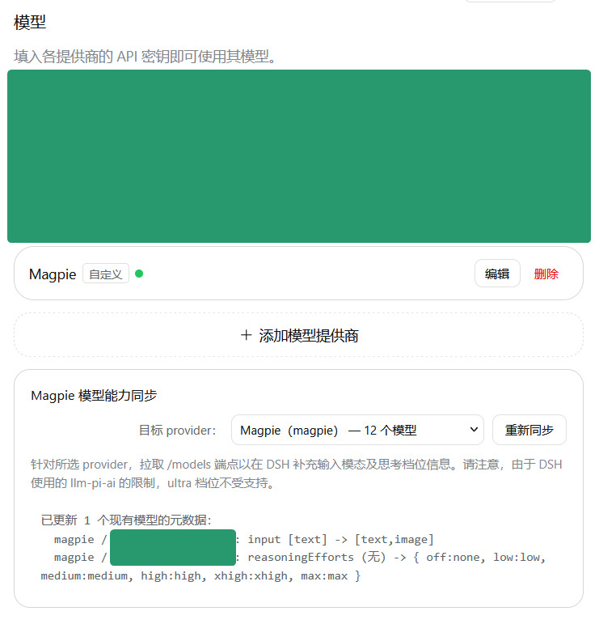

# @ovv/dsh-magpie-sync 

为 DSH 添加利用 [Magpie](https://usemagpie.ai/) 宣告的输入模态及 thinking level 信息的功能。

```sh
dsh plugin --profile web add @ovv/dsh-magpie-sync -w
```



注：DSH 所使用的 llm-pi-ai [只支持以下档位名称](https://github.com/deepseek-ai/deepseek-harness/blob/ce7073d51254c26cd63b22a60835b8f948deb447/packages/llm/llm-pi-ai/src/catalog.ts#L75-L83)：

- off
- minimal
- low
- medium
- high
- xhigh
- max

尤其地，这个列表里没有 `ultra`。此插件暂未提供将 max 档位 map 至实际上的 ultra 的功能。

（以下内容由 LLM 生成）

---

## 同步规则

DSH 内置 `dsh-llm-pi-ai` 在请求第三方 `/v1/models` 时会丢弃某些扩展字段。上游可能返回如下模型能力信息：

```json
{
  "id": "copilot/gpt-6-sol",
  "modalities": { "input": ["text", "image"] },
  "reasoning": true,
  "reasoning_levels": ["none", "low", "medium", "high", "xhigh", "max", "ultra"]
}
```

同步会：

1. 解析 `modalities.input`（兼容 `input_modalities` / `inputModalities`），并将支持的文本、图片输入写入现有模型的 `input` 字段。
2. 兼容 `supported_reasoning_levels`（对象数组或字符串数组）与 `reasoning_levels` 字符串数组，更新现有模型的 `reasoningEfforts`。
3. 将上游的 `none` 映射为 DSH 档位键 `off`，其对应服务端值为 `off: "none"`；保留模型已有的 `off: null` 等现存值。
4. 自动过滤 `ultra` 等 DSH 不支持的档位。DSH 内置的 `llm-pi-ai` 适配器思考强度 Schema（`THINKING_LEVELS`）仅允许 `off`、`minimal`、`low`、`medium`、`high`、`xhigh`、`max` 七个固定档位，不接受 `ultra`。若写入 `ultra`，整个服务提供方配置会校验失败并被拒，因此同步会过滤该档位并在结果中说明原因。

## 安装与使用

```bash
# 从本地仓库路径安装到 web profile
dsh plugin --profile web add @ovv/dsh-magpie-sync -w
```

打开 Web GUI，在左侧进入 **「设置 -> 模型」**，确认目标服务提供方（默认 `magpie`），然后点击 **「立即同步」**。

## 协议

MIT
